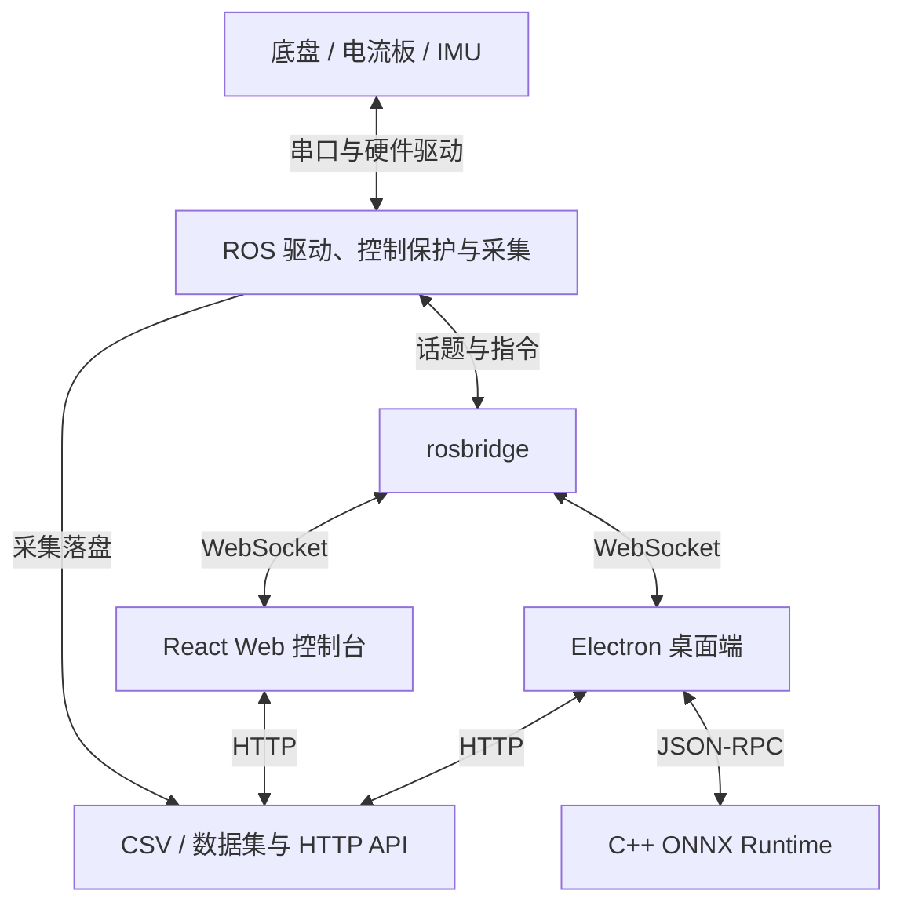

# WHEELTEC 机器人控制与故障诊断平台

**本科毕业设计的应用层维护版本**：面向 WHEELTEC R550PLUS 三全向轮机器人，将运动控制、实验采集、数据管理与桌面故障推理连接起来。

项目作者：**杨鹏（Yang Peng）**。本仓库是同一机器人故障诊断项目的工程入口；传感器与底盘固件、训练数据、模型实验保存在 [完整毕业设计工程](https://github.com/y-gougou/robot-fault-diagnosis-thesis)。

[实现与代码](#项目实现重点) · [系统架构](#系统架构) · [运行入口](#运行入口) · [完整技术说明](docs/project-guide.md)

## 要解决的问题

机器人故障诊断实验需要同时处理底盘控制、传感器监测、故障条件配置和数据记录。仅有分类模型，还需要将采集数据的特征顺序、归一化参数与运行时输入保持一致，才能接入实际系统。

本项目围绕这一过程提供统一的操作入口：

- **实验操作**：通过 Web 或桌面端发送驾驶、巡航、航向与急停指令，配置故障注入和采集任务。
- **过程记录**：采集里程计、轮速、IMU、电流等信号，为 CSV 保存实验标签和 run ID，并提供状态、曲线与数据预览。
- **模型接入**：桌面端聚合时序窗口，通过本机 C++ 推理进程调用 ONNX 模型，显示诊断结果与后端状态。

## 系统能力

| 场景 | 当前工程提供的能力 | 查看实现 |
| --- | --- | --- |
| 机器人控制 | 手动驾驶、巡航指令、航向操作；心跳、超时、急停和限速处理 | [控制适配器](src/cmd_vel_web_adapter_node.cpp) |
| 实验与采集 | 故障轮/参数配置、任务倒计时、采集启停、运行标签和状态反馈 | [实验向导](web/src/components/ExperimentWizard.jsx)、[采集节点](scripts/data_collector.py) |
| 数据管理 | CSV 列表、下载、预览、质量提示、统计及滑动窗口数据集构建 | [Web 控制台](web/README.md)、[数据集脚本](scripts/build_fault_dataset.py) |
| 桌面监控 | ROS 实时曲线、控制入口、CSV 工作区；SQLite 保存设置和索引 | [桌面实现](desktop/renderer/)、[持久化](desktop/db/database.js) |
| 故障推理 | 15 个特征、50 点窗口；模型、scaler、标签配置与 ONNX Runtime 接入 | [推理服务](desktop/inference-service.js)、[推理文档](docs/FAULT_INFERENCE.md) |

上述为仓库中的实现范围，模型评估和实验结果请从 [研究工程](https://github.com/y-gougou/robot-fault-diagnosis-thesis) 阅读；本页不将离线分类结果等同于实车可靠性指标。

## 系统架构



Web 与 Electron 复用机器人侧 ROS 话题和数据 API；Electron 通过本机推理进程扩展诊断功能。控制命令经过适配器再发送到底盘，模型输出用于显示诊断结果。

## 技术栈

| 层次 | 技术 |
| --- | --- |
| 机器人中间件 | ROS 1 Noetic、catkin、C++11、Python 3、串口通信 |
| Web 操作端 | React、Vite、JavaScript、WebSocket、Recharts |
| 桌面应用 | Electron、JavaScript、SQLite / better-sqlite3、IPC |
| 推理接入 | C++、ONNX Runtime、JSON-RPC、模型 manifest 与 scaler |
| 数据处理 | NumPy、pandas、scikit-learn、CSV / NPY |

## 项目实现重点

工程基于 WHEELTEC 底盘与原有驱动扩展，项目实现和维护重点可从以下模块核对：

| 工作模块 | 具体实现 | 代码证据 |
| --- | --- | --- |
| 控制链路保护与驱动修复 | 巡航心跳保护、当前帧 BCC 校验、主循环限速、电流串口状态与配置处理 | [控制节点](src/cmd_vel_web_adapter_node.cpp)、[底盘节点](src/wheeltec_robot.cpp)、[审计记录](AUDIT_0816.md) |
| 实验数据链路 | 将故障配置、run ID、采集启停、CSV 与数据集构建接入操作界面 | [故障注入](scripts/fault_injector.py)、[采集实现](scripts/data_collector.py)、[数据 API](scripts/web_dashboard_server.py) |
| Web 到桌面的功能延伸 | 实现 ROS 客户端、桌面数据工作区、主进程 IPC 和本地持久化 | [ROS 客户端](desktop/renderer/ros-client.js)、[工作区](desktop/renderer/data-workspace.js)、[主进程](desktop/main.js) |
| 模型工程化接入 | 管理推理子进程、按特征窗口组织输入、加载配套模型和归一化配置 | [进程管理](desktop/inference-service.js)、[C++ 推理入口](desktop/inference/onnxruntime/src/main.cpp)、[模型配置](desktop/models/) |

WHEELTEC 基础驱动、STM32/ROS 生态与其他第三方库均保留原有来源和署名；这些基础组件不计作项目独立原创实现。

## 代码与文档导航

- **先了解工程**：[完整技术说明](docs/project-guide.md)、[原始操作参考](docs/reference-guide.md)。
- **看机器人端**：[`src/`](src/)、[`scripts/`](scripts/)、[`launch/`](launch/)、[串口协议](docs/PROTOCOL.md)。
- **看操作界面**：[`web/src/`](web/src/)、[`desktop/renderer/`](desktop/renderer/)、[桌面架构说明](docs/DESKTOP_APP.md)。
- **看部署与推理**：[桌面构建指南](docs/DESKTOP_BUILD_AND_TEST.md)、[故障推理](docs/FAULT_INFERENCE.md)、[依赖声明](package.xml)。
- **看研究与硬件**：[毕业设计系统](https://github.com/y-gougou/robot-fault-diagnosis-thesis)，包含固件、原始数据和模型实验。

## 运行入口

ROS 包名仍为 `turn_on_wheeltec_robot`。先按 [技术说明](docs/project-guide.md#环境与构建) 准备 ROS Noetic 工作空间并编译，避免同一工作空间出现两个同名包。

```bash
source ~/wheeltec_platform_ws/devel/setup.bash
roslaunch turn_on_wheeltec_robot web_control.launch \
  current_port:=/dev/ttyUSB1 \
  start_fdilink_ahrs:=false
```

打开 `http://<机器人IP>:8000/`；rosbridge 为 `ws://<机器人IP>:9090`。上例关闭外置 FDI IMU，硬件串口、N100 航向及采集路径应按实际设备配置。

桌面端在仓库根目录执行：

```bash
cd desktop
npm ci
npm start
```

真实推理还需构建推理后端并配置匹配的模型包，完整步骤见 [桌面构建](docs/DESKTOP_BUILD_AND_TEST.md) 与 [模型接入](docs/FAULT_INFERENCE.md)。

## 已知限制与验证边界

- **硬件与协议**：底盘扩展帧、串口编号和外置 IMU 需匹配实际固件；主 ROS 电流读取使用文本协议，毕业设计中的独立 HostApp/ROS 电流驱动使用二进制解析器。
- **标签与输入一致性**：数据集脚本的 `LABEL_MAP` 将驱动异常设为 1、打滑设为 2；部署模型则将打滑设为 1、驱动异常设为 2。跨流程使用时须显式核对映射。15 通道模型也必须使用配套特征顺序和 scaler，不能混用。
- **可视化资源**：本仓库未包含 `meshes/`，部分 URDF 与安装规则仍引用它。可从历史版本按需取回资产；详见 [meshes 限制](docs/project-guide.md#可选-meshes-与当前限制)。
- **运行环境**：Web/rosbridge 默认无鉴权，面向可信局域网；控制保护参数仍需实车验收。界面启动、离线推理和实车运行是不同验证范围。
- **当前验证**：本次仅整理展示文档并核对代码入口、参数和链接，未新增编译、训练、性能或实车测试结论。

## 来源与许可

本仓库原名 `0816`，维护记录保留在 Git 历史中。[wheeltec-development-history](https://github.com/y-gougou/wheeltec-development-history) 保存早期开发版本与大型网格资产。

作者：杨鹏（Yang Peng）。许可证见 [MIT LICENSE](LICENSE)，`Copyright (c) 2026 Yang Peng`；第三方代码和依赖仍保留各自版权与许可。
