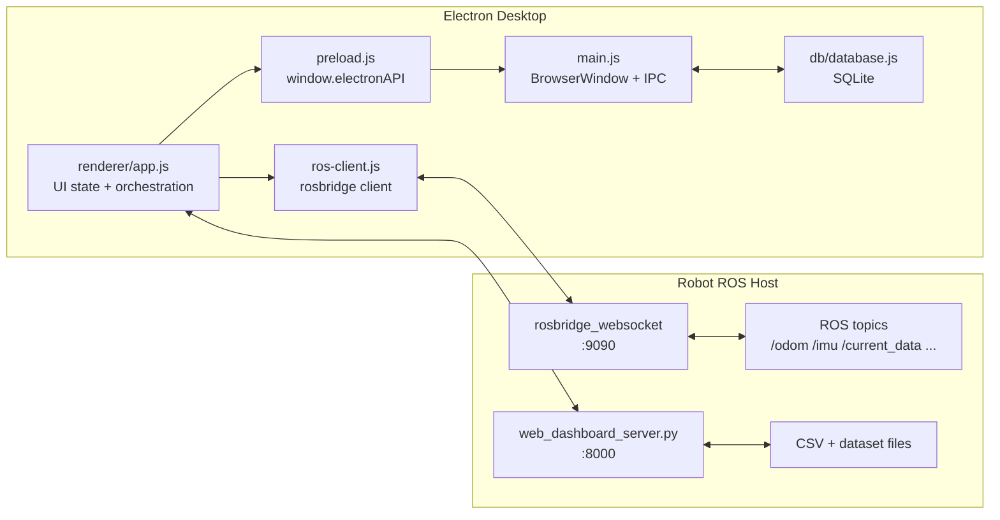

# Electron 桌面端开发文档

本文档记录 `desktop/` 桌面端的当前实现边界、运行方式、架构分层、数据库设计和后续开发约束。它的目标不是替代 ROS 后端文档，而是让后续开发可以围绕 Electron 桌面端继续推进。

## 当前定位

Electron 桌面端是旧 WebUI 的迁移版本，目标是成为后续主要开发入口。它直接连接小车侧 `rosbridge_websocket`，同时复用小车侧 HTTP API 做 CSV 列表、CSV 预览、数据统计和数据集构建。

桌面端目前负责：

- 连接机器人 `ws://<robot_ip>:9090`。
- 展示 `/odom`、`/imu`、`/PowerVoltage`、`/current_data`、`/web/heading_status` 等实时数据。
- 聚合实时 15 通道窗口并调用本机 C++ 推理程序显示故障诊断结果。
- 发布驾驶、急停、巡航、航向归零、故障注入、采集控制等 ROS 指令。
- 调用 `http://<robot_ip>:8000` 下的数据 API。
- 使用本地 SQLite 保存桌面端设置、连接历史、CSV 索引和同步事件。
- 提供主题、语言、字体、字号、窗口背景图等个性化设置。

## 启动方式

### 机器人侧

常用三终端启动方式：

```bash
# 终端 1：底盘控制，提供 /odom /imu /PowerVoltage
roslaunch turn_on_wheeltec_robot turn_on_wheeltec_robot.launch

# 终端 2：数据采集
roslaunch turn_on_wheeltec_robot data_collector.launch fault_label:=0

# 终端 3：Web 控制与 API，避免重复启动底盘/采集/电流节点
roslaunch turn_on_wheeltec_robot web_control.launch start_base:=false start_current_reader:=false start_data_collector:=false
```

如果只启动第三条命令且 `start_base:=false`，桌面端可以连接 rosbridge，但不会收到 `/odom`，速度图和里程计相关数据会保持等待状态。这不是桌面端渲染故障。

### 桌面端

详细的环境准备、`npm start` 测试、快速目录打包和最终安装包流程见：

```text
docs/DESKTOP_BUILD_AND_TEST.md
```

日常开发优先使用：

```powershell
cd "D:\projects\01 ROS\turn_on_wheeltec_robot\desktop"
npm install
npm start
```

`npm start` 直接启动 Electron，不生成安装包，适合界面、ROS 连接、数据采集和推理流程的日常测试。

`better-sqlite3` 是原生依赖，安装后会通过 `postinstall` 自动执行：

```powershell
electron-builder install-app-deps
```

如果更换 Electron 版本、复制了 `node_modules`，或启动时出现 SQLite 原生模块 ABI 错误，手动执行：

```powershell
cd "D:\projects\01 ROS\turn_on_wheeltec_robot\desktop"
npx electron-builder install-app-deps
```

## 打包方式

日常验证打包目录优先使用：

```powershell
cd "D:\projects\01 ROS\turn_on_wheeltec_robot\desktop"
npm run build:infer
npm run build:win:dir
```

Linux/macOS 对应：

```bash
npm run build:infer
npm run build:linux:dir
npm run build:mac:dir
```

最终发布安装包再使用：

```powershell
cd "D:\projects\01 ROS\turn_on_wheeltec_robot\desktop"
npm run build:infer
npm run build:win
npm run build:mac
npm run build:linux
```

产物输出在 `desktop/dist/`。

`build:win:dir`、`build:linux:dir`、`build:mac:dir` 只生成 unpacked 目录，不压缩安装包，速度明显快于完整打包。

如果只验证 UI 和打包流程、不启用真实 ONNX Runtime 推理，可以使用：

```powershell
npm run build:infer:offline
npm run build:win
```

故障诊断推理、模型导出、自定义模型导入、ONNX Runtime 编译和常见问题见：

```text
docs/FAULT_INFERENCE.md
```

Windows 打包如果卡在 `winCodeSign` 解压，并出现 `Cannot create symbolic link`，通常是 Windows 当前用户没有创建符号链接权限。解决方式：

- 以管理员身份运行 PowerShell 后重新打包。
- 或开启 Windows 开发者模式后重新打包。
- 必要时删除缓存目录后重试：`%LOCALAPPDATA%\electron-builder\Cache\winCodeSign`。

当前配置文件是 `desktop/electron-builder.yml`：

- Windows: `nsis` 安装包，图标 `assets/icon.ico`。
- Linux: `AppImage`，图标 `assets/icon.png`。
- macOS: `dmg`，需要在 macOS 上完成完整打包和签名流程。
- 打包文件包括 `main.js`、`preload.js`、`inference-service.js`、`db/`、`renderer/`、`assets/`、`app-config.json` 和 `package.json`。
- `extraResources` 会带上 `inference/onnxruntime/build/` 下的推理程序、ONNX Runtime 动态库、`models/` 和 `release/` 发布元信息。
- 打包前会运行 `npm run prepare:release`，以 `app-config.json` 为准同步版本号、应用名和包名，并生成 `resources/release/release-info.json`。

## 目录结构

```text
desktop/
├── main.js                     # Electron 主进程，窗口与 IPC 注册
├── preload.js                  # 安全暴露 window.electronAPI
├── inference-service.js        # C++ 推理子进程管理
├── electron-builder.yml        # 打包配置
├── package.json                # npm 脚本与依赖
├── app-config.json             # 应用名称/品牌配置
├── build/release/              # 打包前生成的发布元信息
├── assets/
│   ├── icon.ico
│   ├── icon.png
│   └── background.png
├── db/
│   └── database.js             # better-sqlite3 本地数据库
├── inference/
│   ├── onnxruntime/            # C++ ONNX Runtime 推理程序
│   └── tools/                  # 模型导出工具
├── models/
│   └── sage_cnn/               # 默认模型包示例/导出目标
├── renderer/
│   ├── index.html              # 页面结构
│   ├── styles.css              # 主题、布局和组件样式
│   ├── i18n.js                 # 中英文文案
│   ├── topics.js               # ROS topic 常量
│   ├── ros-client.js           # rosbridge WebSocket 客户端
│   ├── charts.js               # Canvas 时间序列图
│   ├── drive.js                # 驾驶指令工具
│   ├── collection.js           # HTTP API 工具
│   ├── data-workspace.js       # CSV 预览、数据统计、数据集构建和构建历史
│   ├── experiment.js           # 实验/故障注入消息工具
│   └── app.js                  # 页面状态、事件绑定和业务编排
└── scripts/
    └── sync-app-name.js         # 同步应用名称配置
```

## 运行时架构



渲染进程不直接访问 Node.js API。需要本地持久化时，通过 `preload.js` 调用 `main.js` 注册的 IPC，再由主进程访问 SQLite。

## ROS 通信

所有 topic 名称集中在 `desktop/renderer/topics.js`，新增或修改 topic 时优先改这里，再到业务代码引用常量。

关键订阅：

| Topic | 类型 | 用途 |
| --- | --- | --- |
| `/odom` | `nav_msgs/Odometry` | 速度、位置、偏航角备用来源 |
| `/imu` | `sensor_msgs/Imu` | IMU 角速度、加速度、航向备用计算 |
| `/PowerVoltage` | `std_msgs/Float32` | 电池电压 |
| `/current_data` | `std_msgs/Float32MultiArray` | 三路电流 |
| `/wheel_speed` | `std_msgs/Float32MultiArray` | 三轮轮速 |
| `/chassis/heading_deg` | `std_msgs/Float32` | 底盘航向角 |
| `/web/heading_status` | `std_msgs/String` | 航向状态、来源、零点反馈 |
| `/web/control_status` | `std_msgs/String` | 驾驶/巡航控制状态 |
| `/web/collection_status` | `std_msgs/String` | 采集状态 |
| `/web/current_reader_status` | `std_msgs/String` | 电流读取器状态 |
| `/web/fault_injection_status` | `std_msgs/String` | 故障注入状态 |

关键发布：

| Topic | 用途 |
| --- | --- |
| `/cmd_vel_web` | 手动驾驶速度指令 |
| `/web/heartbeat` | Web 控制心跳 |
| `/web/estop` | 急停 |
| `/web/cruise_cmd` | 巡航目标速度 |
| `/web/cruise_enable` | 巡航启停 |
| `/web/heading_zero` | 航向归零 |
| `/target_angle` | 目标航向 |
| `/web/collection_config` | 采集配置 |
| `/web/collection_enable` | 采集启停 |
| `/web/current_reader_config` | 电流板端口配置 |
| `/web/fault_injection_config` | Web 故障注入配置 |
| `/chassis/fault_config` | 底盘故障注入配置 |

`RosClient.connect()` 在 WebSocket `onopen` 后会重新订阅已有 handler，避免连接成功但未订阅的竞态。新增实时数据页面时，应先注册 `subscribe()`，连接成功后客户端会自动补发订阅。

## HTTP API

HTTP API 基地址由机器人 IP 推导：

```text
http://<robot_ip>:8000
```

桌面端当前使用的 API：

| API | 用途 |
| --- | --- |
| `/api/data/list` | 获取 CSV 文件列表 |
| `/api/data/preview` | 获取 CSV 表格预览数据 |
| `/api/data/stats` | 获取 CSV 数据统计 |
| `/api/dataset/build` | 启动数据集构建 |
| `/api/dataset/status` | 轮询构建状态和日志 |
| `/api/dataset/list` | 列出已构建数据集 |

CSV 预览设计为表格预览，不是图表。它展示列名、样本行、行数/列数等结构信息，用于快速检查采集数据是否完整、列顺序是否正确、是否存在空值。

## 本地数据库

数据库文件位于 Electron 用户数据目录：

```text
<app.getPath("userData")>/wheeltec.db
```

Windows 常见位置类似：

```text
C:\Users\<用户>\AppData\Roaming\<AppName>\wheeltec.db
```

当前使用 `better-sqlite3`，并启用：

- `journal_mode = WAL`
- `foreign_keys = ON`

### 表结构

| 表 | 作用 |
| --- | --- |
| `schema_migrations` | 数据库迁移版本记录，避免后续表结构升级失控 |
| `settings` | 主题、语言、字体、背景图、字号等本地设置 |
| `robot_connections` | 连接过的机器人 IP 和最近状态 |
| `csv_files` | 从小车 API 同步来的 CSV 文件索引 |
| `dataset_builds` | 数据集构建任务记录、日志、结果和错误状态 |
| `experiments` | 实验开始/停止、参数、采集行数和状态 |
| `experiment_events` | 实验过程事件，例如开始采集、故障应用、故障复位 |
| `sync_events` | 同步事件和连接事件记录 |

### IPC 接口

`main.js` 暴露的数据库 IPC：

| IPC | 用途 |
| --- | --- |
| `db:get-settings` | 读取全部设置 |
| `db:set-setting` | 写入单项设置 |
| `db:get-setting` | 读取单项设置 |
| `db:get-schema-version` | 获取当前/目标数据库版本 |
| `db:list-schema-migrations` | 查询已执行迁移版本 |
| `db:record-connection` | 记录连接历史 |
| `db:list-connections` | 查询连接历史 |
| `db:index-csv-files` | 索引 CSV 文件列表 |
| `db:list-csv-files` | 查询本地 CSV 索引 |
| `db:add-sync-event` | 记录同步事件 |
| `db:start-dataset-build` | 创建数据集构建记录 |
| `db:update-dataset-build` | 更新构建 ID、状态、日志或错误 |
| `db:finish-dataset-build` | 完成数据集构建并写入结果 |
| `db:list-dataset-builds` | 查询最近数据集构建记录 |
| `db:start-experiment` | 创建实验记录 |
| `db:update-experiment` | 更新实验状态或行数 |
| `db:finish-experiment` | 停止实验并记录停止原因 |
| `db:add-experiment-event` | 写入实验事件 |
| `db:list-experiments` | 查询最近实验记录 |

渲染进程通过 `window.electronAPI.db.*` 调用这些接口。新增本地持久化能力时，不要在 renderer 中直接引入 Node.js 模块。

### 迁移约束

当前数据库目标版本为 `3`：

- `1 base_tables`：设置、连接历史、CSV 索引、同步事件。
- `2 dataset_build_tracking`：数据集构建记录、日志、结果、错误。
- `3 experiment_tracking`：实验记录和实验事件。

以后修改表结构时，不要直接在旧 SQL 上追加一次性 `ALTER TABLE`。应在 `desktop/db/database.js` 中新增一个版本号递增的 migration，并保持迁移幂等。对历史版本用户，迁移会在应用启动时按顺序执行；对新用户，迁移会从空库建到最新结构。

## 页面与功能边界

当前页面入口：

- 仪表盘：连接状态、里程计、IMU、电源、轮速、航向、速度曲线、事件日志。
- 驾驶：虚拟摇杆、WASD、方向键、Xbox 手柄、急停、巡航、航向控制。
- 图表：速度、电流、IMU 加速度、航向罗盘。
- 数据采集：CSV 列表、CSV 表格预览、统计、采集控制、电流读取器端口。
- 实验向导：故障类型、轮子选择、系数编辑、实验启动/停止、故障注入。
- 设置：主题、语言、字体、字号、背景图、连接历史、版本信息。

交互上的约束：

- 驾驶快捷键只在输入框之外生效，避免编辑数值时触发移动。
- WASD 使用 `KeyboardEvent.code`，不依赖键盘布局。
- Xbox 手柄默认使用左摇杆控制 `linear.x/y`，RT 作为角速度输入。
- 实验停止必须同时复位 `/web/fault_injection_config` 和 `/chassis/fault_config`，避免底盘残留故障衰减。
- 电流读取器重连必须发送用户输入的 `currentPort`，不能使用固定默认值。

## 国际化约束

静态文案放在 `desktop/renderer/i18n.js`。HTML 中优先使用：

```html
data-i18n="key"
data-i18n-placeholder="key"
```

动态文案也必须通过 `t("key")` 或封装函数生成。Canvas 图表中的等待提示同样要使用函数式文案，切换语言后触发重绘。

检查是否还有遗漏中文：

```powershell
cd "D:\projects\01 ROS\turn_on_wheeltec_robot"
rg -n "[\p{Han}]" desktop\renderer
```

注意：`i18n.js` 中中文翻译属于正常匹配；重点检查 `app.js`、`charts.js`、`index.html` 中是否还有运行时硬编码中文。

## 个性化设置

设置页目前支持：

- 亮色/暗色主题。
- 中文/英文语言。
- 字体族。
- 基础字号。
- 窗口背景图路径。
- 背景透明度。
- 背景模糊。
- 恢复默认外观。

背景图通过 CSS 变量写入：

```css
--app-bg-image
--app-bg-opacity
--app-bg-blur
```

由于背景图可能使用本地文件路径，CSP 已允许 `img-src file:`。未来如果增加文件选择器，建议通过 `preload.js` 暴露受控的 `dialog.showOpenDialog` IPC，而不是让 renderer 获得完整 Node.js 权限。

## 常见问题

### 连接成功但图表没有速度

优先检查小车是否真的发布 `/odom`：

```bash
rostopic hz /odom
```

如果只启动了：

```bash
roslaunch turn_on_wheeltec_robot web_control.launch start_base:=false
```

则 `/odom` 需要由另一个底盘启动命令提供。

### 航向不动

检查：

```bash
rostopic echo /chassis/heading_deg
rostopic echo /web/heading_status
rostopic echo /imu
```

桌面端会优先使用 `/chassis/heading_deg`，没有时尝试从 `/imu` 四元数计算航向。若小车侧没有发布任一有效数据，罗盘会保持默认方向或等待状态。

### 电流只有一半或留白

电流数据来自 `/current_data`，频率通常低于 `/odom`。桌面端图表会根据最近数据自动缩放时间范围，但如果长时间断流，图上会出现数据间隔。优先检查：

```bash
rostopic hz /current_data
```

### 英文模式仍出现中文

一般是动态文案没有走 `i18n.js`。使用：

```powershell
rg -n "[\p{Han}]" desktop\renderer
```

把非翻译表里的中文移动到 `i18n.js`。

### SQLite 启动错误

执行：

```powershell
cd "D:\projects\01 ROS\turn_on_wheeltec_robot\desktop"
npx electron-builder install-app-deps
```

这是 Electron 原生模块 ABI 重建问题，不是数据库文件损坏。

### npm audit 有高危提示

当前依赖树来自 Electron 打包链路。不要直接执行：

```powershell
npm audit fix --force
```

它可能升级破坏 Electron / electron-builder 组合。应先确认漏洞是否影响运行时暴露面，再有选择地升级依赖。

## 静态检查

每次修改后至少运行：

```powershell
cd "D:\projects\01 ROS\turn_on_wheeltec_robot"
node --check desktop\main.js
node --check desktop\preload.js
node --check desktop\db\database.js
Get-ChildItem desktop\renderer -Filter *.js | ForEach-Object { node --check $_.FullName }
```

若修改了 SQLite 依赖或 Electron 版本，额外运行：

```powershell
cd "D:\projects\01 ROS\turn_on_wheeltec_robot\desktop"
npx electron-builder install-app-deps
```

## 下一步建议

优先级建议如下：

1. 继续拆 `app.js`，下一步优先拆外观设置和驾驶输入绑定。
2. 把 CSV 预览的列统计、空值统计、异常值提示做成表格侧边摘要。
3. 给 HTTP API 调用增加统一超时、错误分类和重试策略。
4. 给实验记录补充 `experiment_metrics`，保存电压、电流、航向、速度等关键统计快照。
5. 给数据集构建历史增加“按 build_id 恢复轮询”能力，支持桌面端重启后继续跟踪未完成任务。
6. 增加端到端手测清单，覆盖连接、驾驶、急停、实验停止复位、CSV 预览、数据集构建、语言切换和打包安装。

## 开发原则

- ROS topic 名称只放在 `topics.js`。
- 新文案必须进入 `i18n.js`。
- 新持久化必须走 `preload.js` + `main.js` IPC。
- 页面不要再堆大按钮和空白面板，优先按“状态摘要、主要动作、详细数据”分层。
- 数据预览默认用表格，趋势观察才用图表。
- 机器人断网时，桌面端数据库只保证本地设置、历史索引和最后一次同步记录，不假装数据连续。
