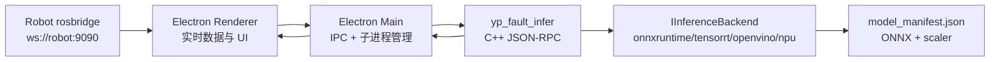

# 桌面端故障诊断推理文档

本文档说明 Electron 桌面端的故障诊断推理架构、模型包格式、ONNX Runtime C++ 后端编译、Windows 打包、自定义模型导入和常见问题。

## 目标

桌面端负责从 rosbridge 订阅小车实时数据，在本机聚合模型输入窗口，并调用本机 C++ 推理程序完成故障类型识别。第一版默认使用 ONNX Runtime，后续可以在同一接口下接入 TensorRT、OpenVINO 或 NPU SDK。

当前推理结果只显示在 Electron UI，不发布回 ROS topic。

## 运行架构



关键文件：

| 文件 | 说明 |
| --- | --- |
| `desktop/inference/onnxruntime/src/main.cpp` | C++ 推理进程，包含 JSON-RPC、预处理、后端工厂、后处理 |
| `desktop/inference/onnxruntime/CMakeLists.txt` | CMake 构建，支持 FetchContent 下载 ONNX Runtime |
| `desktop/inference-service.js` | Electron 主进程侧推理子进程管理 |
| `desktop/renderer/app.js` | 实时 50 点窗口聚合和推理调用 |
| `desktop/models/sage_cnn/model_manifest.json` | 默认模型包清单示例 |
| `desktop/inference/tools/export_sage_cnn_onnx.py` | 将当前 SAGE-CNN `.pth` 导出为 ONNX 模型包 |

## 数据输入

模型输入固定为 50 个时间点、15 个特征通道。Electron 在 `/odom` 到达时采样最新缓存的传感器值，形成一行数据。

特征顺序必须与训练一致：

```text
odom_vx
odom_vy
odom_wz
wheel_speed0
wheel_speed1
wheel_speed2
imu_ax
imu_ay
imu_az
imu_gx
imu_gy
imu_gz
current0
current1
current2
```

窗口规则：

| 参数 | 当前值 | 说明 |
| --- | ---: | --- |
| `window_size` | 50 | 满 50 行后才开始推理 |
| `step_size` | 10 | 每新增 10 行触发一次推理 |
| 输入 shape | `[1, 15, 50]` | C++ 侧将 50x15 原始窗口转置为模型输入 |

`/wheel_speed` 是必要输入。如果没有收到三路轮速，桌面端会显示等待 `/wheel_speed`，不会用 0 静默补齐。

## 模型包格式

桌面端支持用户自行导入模型。一个模型目录建议包含：

```text
my_model/
├── model_manifest.json
├── model.onnx
├── scaler.json
└── feature_config_used.json
```

最小 `model_manifest.json` 示例：

```json
{
  "name": "My Fault Model",
  "backend": "onnxruntime",
  "model_path": "model.onnx",
  "scaler_path": "scaler.json",
  "feature_config_path": "feature_config_used.json",
  "input_shape": [1, 15, 50],
  "labels": ["normal", "drive_abnormal", "wheel_slip", "shaft_eccentricity"],
  "runtime_options": {
    "prefer_cuda": true
  }
}
```

路径规则：

- `model_path` 和 `scaler_path` 可以是绝对路径。
- 相对路径按 `model_manifest.json` 所在目录解析。
- `feature_config_path` 当前主要用于记录和人工核对，推理必需项是 ONNX 和 scaler。

### scaler.json

C++ 推理进程不读取 `.pkl`，必须使用 JSON 格式归一化参数。

MinMaxScaler 格式：

```json
{
  "type": "minmax",
  "min": [0.0, 0.0, 0.0],
  "scale": [1.0, 1.0, 1.0]
}
```

StandardScaler 格式：

```json
{
  "type": "standard",
  "mean": [0.0, 0.0, 0.0],
  "scale": [1.0, 1.0, 1.0]
}
```

实际数组长度必须是 15。`desktop/inference/tools/export_sage_cnn_onnx.py` 会从 `strict_scaler.pkl` 自动导出正确格式。

## 导出当前 SAGE-CNN 模型

如果使用当前训练项目里的 `.pth` 权重，可以执行：

```powershell
cd "D:\projects\01 ROS\turn_on_wheeltec_robot\desktop"
python -m pip install torch onnx joblib scikit-learn
npm run export:model
```

输出位置：

```text
desktop/models/sage_cnn/
├── model_manifest.json
├── sage_cnn_selected_best_model.onnx
├── scaler.json
└── feature_config_used.json
```

如果导出日志里出现 `requested opset_version 17` 或 `Pad` 降级失败，但最后出现：

```text
Exported ONNX model: ...
Exported scaler: ...
```

说明导出已成功，模型通常会保留为 opset 18。可用以下命令检查：

```powershell
python -c "import onnx; m=onnx.load(r'D:\projects\01 ROS\turn_on_wheeltec_robot\desktop\models\sage_cnn\sage_cnn_selected_best_model.onnx'); print(m.opset_import)"
```

## 桌面端模型转换面板

设置页中的“故障诊断”区域提供了模型转换面板，用于把训练工程里的 SAGE-CNN checkpoint 转成桌面端可加载的 ONNX 模型包。

当前转换工具不是通用模型转换器。它要求训练工程能通过 `from models import build_model` 构建 `sage_cnn`，并且已选模型目录中存在固定文件名的权重和归一化文件。

### 使用前准备

首次使用前先在桌面端目录准备本地 Python 运行时和依赖：

```powershell
cd "D:\projects\01 ROS\turn_on_wheeltec_robot\desktop"
npm run setup:env
```

推荐使用 uv 创建的项目内 Python：

```text
D:\projects\01 ROS\turn_on_wheeltec_robot\desktop\python\Scripts\python.exe
```

该 Python 需要能导入：

```text
torch
onnx
joblib
scikit-learn
```

### 面板字段说明

| 字段 | 应填写内容 | 要求 |
| --- | --- | --- |
| `模型清单` | 已导出的 `model_manifest.json` 路径 | 手动加载已有模型时填写；转换成功后会自动回填 |
| `模型代码目录` | 训练工程代码根目录 | 目录中必须能 `from models import build_model` |
| `已选模型目录` | 训练输出的最佳模型目录 | 目录中必须有 `.pth`、scaler 和特征配置 |
| `导出目录` | 转换后的模型包输出目录 | 推荐 `desktop/models/sage_cnn` 或用户数据目录 |
| `Python 运行时` | Python 可执行文件路径 | 推荐 `desktop/python/Scripts/python.exe` |

`已选模型目录` 必须包含：

```text
sage_cnn_selected_best_model.pth
strict_scaler.pkl
feature_config_used.json
```

`模型代码目录` 示例：

```text
C:\Users\86141\Desktop\yp projects\model\model\ypmodel
```

`已选模型目录` 示例：

```text
C:\Users\86141\Desktop\yp projects\model\model\ypmodel\selected_sage_cnn_model
```

`导出目录` 示例：

```text
D:\projects\01 ROS\turn_on_wheeltec_robot\desktop\models\sage_cnn
```

### 操作步骤

1. 打开桌面端设置页。
2. 在“模型代码目录”中填写训练工程根目录。
3. 在“已选模型目录”中填写最佳模型输出目录。
4. 在“导出目录”中填写转换产物保存目录。
5. 确认“Python 运行时”指向项目内 Python。
6. 点击“转换模型”。
7. 转换成功后，桌面端会生成 `model_manifest.json`，自动回填“模型清单”，并尝试重新加载模型。

转换成功后输出目录应包含：

```text
model_manifest.json
sage_cnn_selected_best_model.onnx
scaler.json
feature_config_used.json
```

状态从 `model not loaded` 变为 `ready` 后，说明模型已被 C++ 推理进程加载。

### 后台执行的命令

界面点击“转换模型”时，主进程会调用：

```powershell
python inference\tools\export_sage_cnn_onnx.py `
  --model-root "<模型代码目录>" `
  --selected-dir "<已选模型目录>" `
  --output-dir "<导出目录>" `
  --name "SAGE-CNN selected"
```

也可以在命令行手动执行同样的转换：

```powershell
cd "D:\projects\01 ROS\turn_on_wheeltec_robot\desktop"
.\python\Scripts\python.exe .\inference\tools\export_sage_cnn_onnx.py `
  --model-root "C:\Users\86141\Desktop\yp projects\model\model\ypmodel" `
  --selected-dir "C:\Users\86141\Desktop\yp projects\model\model\ypmodel\selected_sage_cnn_model" `
  --output-dir "D:\projects\01 ROS\turn_on_wheeltec_robot\desktop\models\sage_cnn"
```

### 常见转换错误

| 错误 | 含义 | 处理 |
| --- | --- | --- |
| `Model root not found` | 模型代码目录不存在 | 检查“模型代码目录”路径 |
| `Selected model directory not found` | 已选模型目录不存在 | 检查“已选模型目录”路径 |
| `No module named models` | 训练工程根目录不对 | 确保目录中能导入 `models` |
| `cannot import build_model` | 训练工程模型构建入口不匹配 | 检查 `models.py` 或 `models/__init__.py` |
| `sage_cnn_selected_best_model.pth` not found | 缺权重文件 | 选择包含最佳权重的目录 |
| `strict_scaler.pkl` not found | 缺训练归一化器 | 从训练输出中复制 scaler |
| `feature_config_used.json` not found | 缺特征配置记录 | 从训练输出中复制特征配置 |
| `No module named torch/onnx/joblib/sklearn` | Python 依赖不完整 | 运行 `npm run setup:env` |

## 编译推理程序

### 真实 ONNX Runtime 后端

默认命令：

```powershell
cd "D:\projects\01 ROS\turn_on_wheeltec_robot\desktop"
npm run build:infer
```

`build:infer` 会执行 `desktop/scripts/build-infer.js`：

- Windows 上优先使用 Visual Studio Build Tools 2022。
- CMake 默认通过 FetchContent 下载 ONNX Runtime 预编译 CPU 包。
- 编译后自动把 `onnxruntime.dll` 复制到 `yp_fault_infer.exe` 同目录。

Windows 推荐安装：

```text
Visual Studio Build Tools 2022
工作负载: Desktop development with C++
```

如果 GitHub 下载慢，可以指定镜像或本地 SDK：

```powershell
# 使用本地已解压的 ONNX Runtime
$env:ONNXRUNTIME_ROOT="C:\path\to\onnxruntime"
npm run build:infer

# 使用镜像 URL
cmake -S inference/onnxruntime -B inference/onnxruntime/build `
  -DYP_ONNXRUNTIME_PACKAGE_URL="https://your-mirror/onnxruntime-win-x64-1.18.1.zip"
cmake --build inference/onnxruntime/build --config Release
```

### 离线占位后端

只想验证 UI、打包流程和 JSON-RPC 协议时：

```powershell
npm run build:infer:offline
```

该模式不链接 ONNX Runtime，程序仍可启动并返回后端列表，但 `onnxruntime` 会显示 unavailable。它不能进行真实推理。

## 打包

预置当前模型的完整打包流程：

```powershell
cd "D:\projects\01 ROS\turn_on_wheeltec_robot\desktop"
npm run export:model
npm run build:infer
npm run build:win
```

用户后续自行导入模型时，可以不导出预置模型：

```powershell
cd "D:\projects\01 ROS\turn_on_wheeltec_robot\desktop"
npm run build:infer
npm run build:win
```

如果只是打包 UI 占位版本：

```powershell
npm run build:infer:offline
npm run build:win
```

`electron-builder.yml` 会把以下资源放入安装包：

- `inference/onnxruntime/build/yp_fault_infer.exe`
- `inference/onnxruntime/build/onnxruntime.dll` 或 Linux `.so`
- `desktop/models/`

产物输出在：

```text
desktop/dist/
```

## 桌面端导入自定义模型

启动桌面端后：

1. 打开设置页。
2. 找到 `Fault Inference`。
3. 在 `Model Manifest` 中填入自定义 `model_manifest.json` 路径。
4. 点击 `Reload`。
5. 回到仪表盘查看推理状态。

如果模型未加载成功，仪表盘故障诊断卡片会显示错误信息。

导入自定义模型时必须保证：

- ONNX 输入名为 `input`。
- ONNX 输出名为 `logits`。
- 输入 shape 与 manifest 一致，当前 UI 聚合逻辑固定为 `[1, 15, 50]`。
- `scaler.json` 与训练时使用的归一化方式一致。
- label 顺序与训练类别顺序一致。

## JSON-RPC 协议

Electron 主进程通过 stdin/stdout 与 C++ 程序通信，每行一个 JSON。

### list_backends

请求：

```json
{"id":"1","method":"list_backends","params":{}}
```

响应：

```json
{
  "id": "1",
  "ok": true,
  "result": {
    "backends": [
      {"name": "onnxruntime", "available": true},
      {"name": "tensorrt", "available": false, "error": "reserved but not compiled"}
    ]
  }
}
```

### load_model

请求：

```json
{
  "id": "2",
  "method": "load_model",
  "params": {
    "manifest_path": "D:\\models\\my_model\\model_manifest.json"
  }
}
```

### predict

请求中的 `window` 是 50 行，每行 15 个原始特征值：

```json
{
  "id": "3",
  "method": "predict",
  "params": {
    "window": [[0.0, 0.0, 0.0]]
  }
}
```

真实请求必须提供完整 50x15 数组。

统一输出：

```json
{
  "class_id": 0,
  "class_name": "normal",
  "confidence": 0.98,
  "probabilities": [0.98, 0.01, 0.01, 0.0],
  "latency_ms": 2.3,
  "backend": "onnxruntime",
  "device": "CPUExecutionProvider",
  "error": ""
}
```

## 后续后端扩展

新增后端时只需要遵守 `IInferenceBackend`：

```cpp
class IInferenceBackend {
 public:
  virtual void load(const ModelConfig& config) = 0;
  virtual PredictResult predict(const std::vector<float>& input,
                                const std::vector<int64_t>& shape) = 0;
  virtual std::string status_json() const = 0;
  virtual void unload() = 0;
};
```

约束：

- 新后端只负责 `tensor -> logits`。
- 预处理仍由公共 scaler 逻辑完成。
- softmax 和 label 映射仍由公共后处理完成。
- 后端不可改变 Electron JSON-RPC 输出格式。

预留后端名：

| backend | 目标 |
| --- | --- |
| `tensorrt` | NVIDIA TensorRT engine |
| `openvino` | Intel OpenVINO IR / compiled model |
| `npu` | 厂商 NPU SDK |

## 常见问题

### npm run build:infer 报 nmake 找不到

说明 CMake 默认找到了 NMake 生成器，但当前终端没有 Visual Studio 编译环境。

已通过 `scripts/build-infer.js` 避免大部分默认生成器问题。真实 ONNX Runtime 后端仍建议安装 Visual Studio Build Tools 2022。

如果只想测试 UI：

```powershell
npm run build:infer:offline
```

### Visual Studio 17 2022 could not find any instance

说明机器上没有完整 VS 2022 C++ 构建工具，或只残留了不完整安装痕迹。安装：

```text
Visual Studio Build Tools 2022
Desktop development with C++
```

安装后重新打开 PowerShell，再运行：

```powershell
npm run build:infer
```

### npm run export:model 缺 joblib

安装导出依赖：

```powershell
python -m pip install joblib scikit-learn torch onnx
npm run export:model
```

### 导出时提示 opset 17 转换失败

如果最后仍输出 `Exported ONNX model`，通常可以继续使用。该提示表示 PyTorch 使用 opset 18 导出，降级到 17 失败。后续可把导出脚本默认 opset 调整为 18，减少警告。

### 桌面端一直显示等待 /wheel_speed

检查机器人侧是否发布轮速：

```bash
rostopic hz /wheel_speed
```

模型需要三路轮速输入。当前版本不会用 0 自动填补缺失轮速。

### 推理卡显示 backend unavailable

常见原因：

- 使用了 `build:infer:offline`。
- `ONNXRUNTIME_ROOT` 无效。
- FetchContent 下载失败。
- 打包时没有把 `onnxruntime.dll` 放到推理 exe 同目录。

先运行：

```powershell
cd "D:\projects\01 ROS\turn_on_wheeltec_robot\desktop"
.\inference\onnxruntime\build\yp_fault_infer.exe
```

然后输入：

```json
{"id":"1","method":"list_backends","params":{}}
```

查看 `onnxruntime` 是否 available。

## 验证清单

每次修改推理相关代码后建议运行：

```powershell
cd "D:\projects\01 ROS\turn_on_wheeltec_robot\desktop"
node --check main.js
node --check preload.js
node --check inference-service.js
node --check renderer\app.js
node --check scripts\build-infer.js
node -e "JSON.parse(require('fs').readFileSync('models/sage_cnn/model_manifest.json','utf8')); console.log('manifest ok')"
npm run build:infer:offline
```

真实推理验收：

```powershell
npm run export:model
npm run build:infer
npm start
```

连接机器人后确认：

- `/odom`、IMU、电流、轮速都有数据。
- 故障诊断卡片从“准备中”变为“就绪”。
- 满 50 点后每 10 点刷新一次结果。
- 缺 `/wheel_speed` 时显示等待，不输出假结果。
